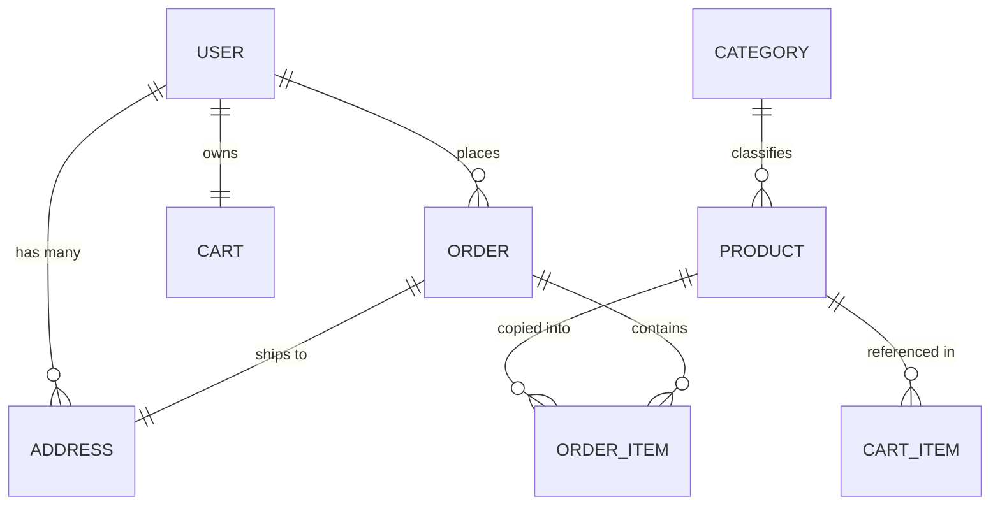

# 🛍️ StoreCraft — Physical Store MERN E-Commerce Platform

[](https://reactjs.org/)
[](https://vitejs.dev/)
[](https://redux-toolkit.js.org/)
[](https://tailwindcss.com/)
[](https://nodejs.org/)
[](https://expressjs.com/)
[](https://www.mongodb.com/)
[](https://razorpay.com/)

A modern, production-ready full-stack **MERN E-Commerce platform** engineered for brick-and-mortar retail stores expanding into digital commerce. Customers can browse real-time store inventory, filter by categories and prices, place orders with Cash on Delivery or Razorpay online payments, manage shipping addresses, and track order fulfillment. An integrated Admin Command Center allows store managers to oversee sales, update stock, upload multi-angle product photography, and manage customer orders.

---

## 📑 Table of Contents

- [Key Features](#-key-features)
  - [Customer Storefront](#customer-storefront)
  - [Admin Command Center](#admin-command-center)
  - [Security & Architecture](#security--architecture)
- [Tech Stack](#-tech-stack)
- [Repository Structure](#-repository-structure)
- [Quick Start Guide](#-quick-start-guide)
  - [Prerequisites](#prerequisites)
  - [Installation & Running Frontend](#installation--running-frontend)
  - [Environment Variables](#environment-variables)
- [Interactive Demo Mode (Mock Engine)](#-interactive-demo-mode-mock-engine)
- [REST API Reference & Backend Architecture](#-rest-api-reference--backend-architecture)
- [Database Schema Design (Mongoose)](#-database-schema-design-mongoose)
- [Demo Credentials](#-demo-credentials)
- [Contributing & License](#-license)

---

## ✨ Key Features

### Customer Storefront
- 🚀 **Lightning Fast Product Browsing:** Fast server & client-side catalog navigation with instant category filtering, price range sliders, stock status toggles, and multi-criteria sorting (price high/low, newest, ratings).
- 🔍 **Live Search Engine:** Debounced search query bar with instant results across titles, categories, and tags.
- 📦 **Dynamic Cart System:** Real-time stock validation, quantity adjusters, subtotal computations, and persistence across sessions.
- 📍 **Multi-Address Management:** Save, edit, delete, and set default shipping/delivery addresses.
- 💳 **Flexible Checkout & Payments:**
  - **Razorpay Online Gateway:** Integrated test checkout with signature validation.
  - **Cash on Delivery (COD):** One-click order placement for local customers.
- 📋 **Order Lifecycle Tracking:** Detailed order timeline (`Pending` → `Confirmed` → `Processing` → `Shipped` → `OutForDelivery` → `Delivered`), order receipts, item snapshots, and delivery summaries.
- 👤 **Customer Account Hub:** Profile details management and order history archive.

### Admin Command Center
- 📊 **Executive Dashboard:** Live metrics for total revenue, active orders, product inventory health, and registered user growth.
- 🏷️ **Product Management:**
  - Complete CRUD (Add, Edit, Delete, View).
  - Multi-image Cloudinary upload support (up to 6 high-res images).
  - Stock level indicators, SKU tracking, pricing & discount controls, and featured flags.
- 🗂️ **Category Governance:** Create, update, toggle active status, and assign imagery to catalog categories.
- 🚚 **Order Processing Pipeline:** Review all customer orders, filter by status, inspect itemized lists, and transition order stages (`Shipped`, `Delivered`, `Cancelled`).
- 👥 **Customer Management:** View registered user accounts, contact details, and account statuses.

### Security & Architecture
- 🛡️ **Role-Based Access Control (RBAC):** Strict route guards (`ProtectedRoute` for authenticated customers, `AdminRoute` exclusively for administrators).
- 🔐 **Stateless JWT Authentication:** Bearer token handling with automated 401 interceptor logout and session cleanup.
- ⚡ **Zero-Trust Calculations:** Product pricing, discounts, shipping fees, and inventory verification enforced strictly server-side.
- 🎨 **Responsive Glassmorphic UI:** Built with Tailwind CSS, custom loading skeleton placeholders, empty state illustrations, and accessible toast alerts.

---

## 🛠️ Tech Stack

### Frontend Application
| Layer | Technologies |
| :--- | :--- |
| **Framework & Core** | [React 18](https://reactjs.org/) + [Vite](https://vitejs.dev/) (ES Modules) |
| **State Management** | [Redux Toolkit](https://redux-toolkit.js.org/) (`authSlice`, `cartSlice`, `productSlice`, `orderSlice`) |
| **Styling & UI** | [Tailwind CSS 3.4](https://tailwindcss.com/) + [PostCSS](https://postcss.org/) + [Autoprefixer](https://github.com/postcss/autoprefixer) |
| **Routing** | [React Router DOM v6](https://reactrouter.com/) (Nested routes, layout wrappers, dynamic segments) |
| **Networking** | [Axios](https://axios-http.com/) (Custom interceptors, Bearer injection, auto mock fallback) |
| **Icons & Notifications** | [React Icons (Lucide / Fi / Fa / Bi)](https://react-icons.github.io/react-icons/) + [React Hot Toast](https://react-hot-toast.com/) |

### Backend & Database (Reference Architecture)
| Layer | Technologies |
| :--- | :--- |
| **Runtime & Server** | [Node.js](https://nodejs.org/) + [Express.js](https://expressjs.com/) (ESM) |
| **Database & ODM** | [MongoDB](https://www.mongodb.com/) + [Mongoose](https://mongoosejs.com/) (Compound indexes, lean queries) |
| **Media & Storage** | [Cloudinary](https://cloudinary.com/) + [Multer](https://github.com/expressjs/multer) (Automated uploads & deletions) |
| **Security & Auth** | [JSON Web Tokens (JWT)](https://jwt.io/) + [bcryptjs](https://github.com/dcodeIO/bcrypt.js) |
| **Payment Gateway** | [Razorpay Node SDK](https://razorpay.com/docs/payments/server-integration/nodejs/) |

---

## 📂 Repository Structure

```text
E-commerce-Webiste---2/
├── frontend/                     # React + Vite Client Application
│   ├── public/                   # Static assets & favicon
│   ├── src/
│   │   ├── api/
│   │   │   ├── axios.js          # Configured Axios instance with interceptors & mock fallback
│   │   │   └── mockData.js       # Seed data for immediate standalone demonstration
│   │   ├── components/
│   │   │   ├── address/          # Address cards, selectors, modals
│   │   │   ├── admin/            # Admin sidebar, header, stat cards, tables
│   │   │   ├── cart/             # Cart drawer, items, order summary
│   │   │   ├── common/           # Skeletons, empty states, modals, badges, inputs
│   │   │   ├── layout/           # Global Navbar, search bar, footer, banner
│   │   │   ├── order/            # Order timeline, item receipts, status badges
│   │   │   └── product/          # Product cards, grids, filters, image galleries
│   │   ├── features/             # Redux slices (auth, cart, orders, products)
│   │   ├── pages/
│   │   │   ├── admin/            # Dashboard, products CRUD, orders, users, categories
│   │   │   ├── auth/             # Login, Register
│   │   │   ├── customer/         # Cart, Checkout, Address, Payment, Order detail/history, Profile
│   │   │   └── public/           # Home, Catalog, Product Detail, Search, Category views
│   │   ├── routes/               # AppRoutes, ProtectedRoute, AdminRoute
│   │   ├── store/                # Redux Toolkit store configuration
│   │   ├── App.jsx               # Root component with Toast Provider & router
│   │   ├── index.css             # Tailwind imports & custom scrollbar / utility styles
│   │   └── main.jsx              # Entry point mounting React DOM & Redux Provider
│   ├── .env                      # Frontend environment configuration
│   ├── package.json              # Frontend scripts & dependencies
│   ├── tailwind.config.js        # Custom Tailwind design tokens & themes
│   └── vite.config.js            # Vite build configuration
├── backend.md                    # Complete production-oriented REST API architectural spec
├── database.md                   # Full MongoDB schema design & indexing specification
├── frontend.md                   # Complete frontend functional requirements specification
└── README.md                     # Project documentation & reference manual
```

---

## 🚀 Quick Start Guide

### Prerequisites
- [Node.js](https://nodejs.org/) v18.0.0 or higher
- [npm](https://www.npmjs.com/) v9.0.0 or higher (or `pnpm` / `yarn`)
- Modern web browser (Chrome, Firefox, Safari, Edge)

### Installation & Running Frontend

1. **Clone the repository:**
   ```bash
   git clone https://github.com/Shivam-Agarwal-8582/E-commerce-Webiste---2.git
   cd E-commerce-Webiste---2
   ```

2. **Navigate to the frontend directory:**
   ```bash
   cd frontend
   ```

3. **Install dependencies:**
   ```bash
   npm install
   ```

4. **Start the development server:**
   ```bash
   npm run dev
   ```

5. **Open your browser:**
   ```
   http://localhost:5173
   ```

6. **Production Build:**
   ```bash
   npm run build
   npm run preview
   ```

---

## ⚙️ Environment Variables

The frontend is configured via `frontend/.env`:

```env
# Backend REST API Base URL
VITE_API_URL=http://localhost:5000/api

# Razorpay Client-Side Key ID (Public test key)
VITE_RAZORPAY_KEY_ID=rzp_test_shop12345678
```

> **Note:** If the backend server at `http://localhost:5000/api` is not reachable, the frontend automatically activates its built-in **Local Storage Mock Engine**, allowing you to preview and test the complete customer and admin flows immediately without any setup!

---

## ⚡ Interactive Demo Mode (Mock Engine)

The frontend includes an intelligent failover layer (`src/api/axios.js` & `src/api/mockData.js`). If a request to your live backend times out or returns a network error, the application seamlessly handles operations against `localStorage`:

- ✅ **Catalog Browsing & Search:** Pre-loaded with retail shop products (electronics, groceries, clothing, home essentials).
- ✅ **Cart & Address Book:** Persists items and user addresses in client storage.
- ✅ **Checkout Flow:** Simulates order creation, address selection, and payment confirmation.
- ✅ **Admin Actions:** You can add new products, edit pricing/stock, update order statuses, and create categories with immediate local reflection.

---

## 📡 REST API Reference & Backend Architecture

The backend REST API blueprint is documented in detail in [`backend.md`](./backend.md). Below is the core route mapping:

### 🔐 Authentication (`/api/auth`)
| Method | Endpoint | Access | Description |
| :--- | :--- | :--- | :--- |
| `POST` | `/api/auth/register` | Public | Register new customer account |
| `POST` | `/api/auth/login` | Public | Authenticate user & return JWT token |
| `POST` | `/api/auth/logout` | Authenticated | Clear user session / cookie |
| `GET` | `/api/auth/me` | Authenticated | Get current authenticated user profile |

### 📦 Products (`/api/products`)
| Method | Endpoint | Access | Description |
| :--- | :--- | :--- | :--- |
| `GET` | `/api/products` | Public | Paginated list with filtering (`search`, `category`, `minPrice`, `maxPrice`, `inStock`, `sort`) |
| `GET` | `/api/products/:id` | Public | Get single product by Mongo ID |
| `GET` | `/api/products/slug/:slug` | Public | Get single product by SEO slug |
| `POST` | `/api/products` | **Admin Only** | Create product (multipart/form-data with Cloudinary upload) |
| `PUT` | `/api/products/:id` | **Admin Only** | Update product information, price, images, or inventory |
| `DELETE` | `/api/products/:id` | **Admin Only** | Delete product and associated Cloudinary assets |

### 🏷️ Categories (`/api/categories`)
| Method | Endpoint | Access | Description |
| :--- | :--- | :--- | :--- |
| `GET` | `/api/categories` | Public | Fetch all active categories |
| `POST` | `/api/categories` | **Admin Only** | Create new product category |
| `PUT` | `/api/categories/:id` | **Admin Only** | Update category title, slug, or image |
| `DELETE` | `/api/categories/:id` | **Admin Only** | Remove category |

### 🛒 Cart (`/api/cart`)
| Method | Endpoint | Access | Description |
| :--- | :--- | :--- | :--- |
| `GET` | `/api/cart` | Customer | Retrieve user cart with verified database prices |
| `POST` | `/api/cart` | Customer | Add product to cart with requested quantity |
| `PUT` | `/api/cart/:productId` | Customer | Update item quantity |
| `DELETE` | `/api/cart/:productId` | Customer | Remove specific item from cart |
| `DELETE` | `/api/cart` | Customer | Clear all items from cart |

### 📍 Addresses (`/api/addresses`)
| Method | Endpoint | Access | Description |
| :--- | :--- | :--- | :--- |
| `GET` | `/api/addresses` | Customer | Get all saved addresses for user |
| `POST` | `/api/addresses` | Customer | Add new delivery address |
| `PUT` | `/api/addresses/:id` | Customer | Update existing address |
| `DELETE` | `/api/addresses/:id` | Customer | Delete address |
| `PATCH` | `/api/addresses/:id/default` | Customer | Mark address as primary / default |

### 📑 Orders & Checkout (`/api/orders`)
| Method | Endpoint | Access | Description |
| :--- | :--- | :--- | :--- |
| `POST` | `/api/orders` | Customer | Validate cart stock, calculate totals on server, create order |
| `GET` | `/api/orders/my-orders` | Customer | Retrieve order history for logged-in user |
| `GET` | `/api/orders/:id` | Customer / Admin | Retrieve individual order receipt and shipping breakdown |

### 💳 Payments (`/api/payments`)
| Method | Endpoint | Access | Description |
| :--- | :--- | :--- | :--- |
| `POST` | `/api/payments/razorpay/create-order` | Customer | Create Razorpay order ID for checkout |
| `POST` | `/api/payments/razorpay/verify` | Customer | Verify HMAC SHA256 payment signature & update order |

### 🛡️ Admin Management (`/api/admin`)
| Method | Endpoint | Access | Description |
| :--- | :--- | :--- | :--- |
| `GET` | `/api/admin/dashboard` | **Admin Only** | Summary metrics: total revenue, order count, stock alert |
| `GET` | `/api/admin/orders` | **Admin Only** | View and filter all customer orders across the store |
| `PATCH`| `/api/admin/orders/:id/status` | **Admin Only** | Advance order status (`Processing`, `Shipped`, `Delivered`) |
| `GET` | `/api/admin/users` | **Admin Only** | View list of registered store customers |

---

## 🗄️ Database Schema Design (Mongoose)

Detailed database models, relations, indexing strategies, and constraints are outlined in [`database.md`](./database.md):



- **User Model:** Name, email (unique index), password (bcrypt), phone, role (`customer` / `admin`), active status.
- **Product Model:** Name, slug (unique index), SKU, description, pricing (`price`, `discountPrice`), stock count, category reference, images array (`publicId`, `url`), featured flag.
- **Category Model:** Name, slug, description, image, active toggle.
- **Cart Model:** Single user reference, embedded array of item references with desired quantities.
- **Address Model:** Full name, phone, address lines, landmark, city, state, postal code, default flag.
- **Order Model:** Auto-generated order number, snapshot of item data (`name`, `price`, `image`), shipping address snapshot, subtotal, shipping fee, total amount, payment method (`COD` / `RAZORPAY`), payment status, and order status.

---

## 🔑 Demo Credentials

When running the application with the local fallback or after seeding your database:

| Role | Email | Password |
| :--- | :--- | :--- |
| **Admin** | `admin@shop.com` | `admin1234` |
| **Customer** | `customer@shop.com` | `customer123` |

> Or simply click **"Register"** in the navigation bar to create a brand new customer account.

---

## 📄 License

This project is licensed under the [MIT License](LICENSE). Feel free to adapt and customize it for your retail or online commerce operations.
